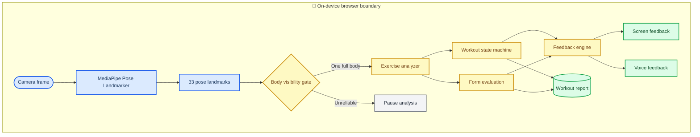

# FormCheck AI architecture

_Canonical Mermaid source for the on-device pose and workout decision pipeline._

---

## 🏗️ Processing pipeline

All camera perception, exercise decisions, feedback, and report construction execute inside the browser. The current application has no workout backend.

## ⚙️ Engineering principle

> “We use AI where perception is needed and deterministic rules where consistent exercise decisions are needed.”

MediaPipe supplies perception: 33 image/world landmarks from the camera frame. FormCheck then uses explicit confidence gates, temporal smoothing, hysteresis, minimum state durations, exercise state machines, scoring rules, and feedback cooldowns. A low-confidence observation suspends evaluation; it is not converted into bad form.

## 🔐 Data boundary

- Camera pixels are read by the local `HTMLVideoElement` and discarded after inference
- Model and WASM assets are served from the same deployment origin
- Routine and workout summaries remain in browser `localStorage`
- Landmark replay exists only in QA mode, begins only after Record, and downloads only after Export
- No login, remote inference, analytics SDK, video upload, or cloud synchronization exists in this version
